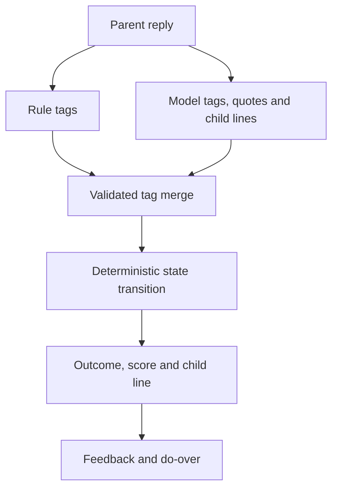

# Do-Over

Do-Over is a responsive practice simulator for parents of children aged 2–7. Answer a simulated child under time pressure, see the moves detected in your words, and replay any turn. No account is needed. It is a practice tool, not therapy, medical advice or a diagnosis.

**A and B are now one merged product, published in [PR #6](https://github.com/mrxfsociety/veltral-businesscap2.0/pull/6) on [`codex/unified-product`](https://github.com/mrxfsociety/veltral-businesscap2.0/tree/codex/unified-product).** The unified source combines the latest reviewed engine, model/server work and complete B1–B5 interface, including voice. Exact-lock installation and full verification passed: **435 tests in 30 files, with real Redis and no skipped tests**, lint, strict TypeScript, all five evaluation gates and both Pro and Free production builds. See [the unified report](docs/build/UNIFIED-REPORT.md) for the executed checks and remaining acceptance gates.

The existing deployment is [veltral.aituconnect.kz](https://veltral.aituconnect.kz). Health observed on 14 November 2026 at 17:22 UTC still reported review commit `afb43807`; **the new unified commit has not been deployed**. This handoff targets GitHub. Team acceptance, human label review and real-device microphone testing remain outstanding.

## Run locally

Node 24 or newer is required. This verification used Node 24.22.3 and Redis 7.4.12; the Docker deployment targets Node 26 LTS.

```sh
npm ci
cp .env.example .env.local
npm run dev
```

Open <http://localhost:3000> and set `SITE_URL=http://localhost:3000` for local metadata. Empty provider credentials use deterministic rules and child templates. The UI labels this "Tagged by rules only"; model-dependent features report unavailable states or documented fallbacks.

The owner selected OpenAI only: the reviewed deployment uses `OPENAI_MODEL=gpt-6-luna`, `OPENAI_REASONING_EFFORT=none`, `OPENAI_TEXT_VERBOSITY=low`, `LLM_PRIMARY=openai` and empty Anthropic credentials. Keep keys in ignored environment files. Optional Anthropic adapter code is retained but unused.

`NEXT_PUBLIC_PRO_PREVIEW=true` unlocks Pro features for evaluation. Set it to `false` before rebuilding to exercise Free limits. Payments are not connected; prices are explicitly planned prices.

## What is included

- Twelve scenes, daily rotation, an 8/20-second or off timer, and a 25-second window after typing starts.
- A deterministic 19-tag engine, evidence quotes, arousal/connection feedback, four outcomes and unscored unsafe pauses.
- Turn-by-turn debrief, do-over with earlier turns retained, playbook saving/sharing, local history and progress.
- Custom-scene generation, engine-checked coach suggestions, real daily standings, waitlist and Free/Pro gating.
- Landing, privacy and how-it-works pages showing actual engine definitions, constants and measured accuracy.
- Optional Pro voice: calibration, bounded microphone recording, sustained loudness detection, transcription, stored-child-line playback and typing fallback.
- Non-root standalone container delivery, private persistent Redis, the existing nginx deployment path and a separate Caddy setup for new hosts.

## How it works



`src/engine` alone determines outcomes and scores. `src/llm` proposes semantic tags with checked evidence quotes and possible child lines. `src/server` owns state, storage and request handling; the browser never supplies authoritative state, tags or scores. Model deadlines fall back safely to rules. Unsafe and empty replies skip the model.

Only eligible first daily attempts enter standings, with percentages withheld below 20 players. Do-overs replace the selected turn onward and do not create a new ranked attempt. Redis failure switches to bounded sticky memory storage. Browser storage failures are reported honestly, and failed playbook saves or deletions preserve the previously saved lines.

## Measured accuracy

The figures below come from [`eval/results.json`](eval/results.json). [`docs/MODEL.md`](docs/MODEL.md) contains generated per-tag support and methodology.

| Test split: 63 replies  | Rules only | Rules + OpenAI |
| ----------------------- | ---------: | -------------: |
| Micro-F1                |     98.59% |         96.64% |
| Exact-set match         |     96.83% |         92.06% |
| Unhelpful-tag precision |    100.00% |         89.74% |

Rules outperform model-assisted tagging on this small supplied set. The corpus has 137 AI-drafted replies: 74 dev and 63 test. Human review of all labels is unconfirmed; `labelsReviewedByHuman` remains false. Labels were not changed to improve scores, and dev disputes remain recorded in [STATUS.md](docs/build/STATUS.md).

The rules evaluation was rerun during unified verification. OpenAI measurements and live feature/audio evidence are preserved from track A's executed checks, **not rerun by this no-key integration pass**. Accuracy collection used a recorded longer deadline than the four-second runtime limit; the model report distinguishes those methods. No transfer to real-life parenting, retention or willingness to pay has been measured.

## Verification

```sh
RUN_REDIS_INTEGRATION=1 npm run verify
npm run par
npm run check:eval-isolation
npm run e2e
NEXT_PUBLIC_PRO_PREVIEW=false npm run e2e
npm run shots
```

The unified check used the exact lockfile, including a clean `npm ci` of 411 packages. In addition to the full verification gate, 31 HTTP checks exercised 46 turn requests across all ages and outcomes; nine rendered routes, the Open Graph image and exact displayed evaluation tables were checked. Browser inspection confirmed a daily calm ending in three turns at par 3, saved-line persistence after reload, preserved do-over prefixes without ranking, calibration cancellation and no horizontal overflow at 375 px.

The Free configuration also passed the full 435-test verification and production build. Browser checks confirmed gated non-daily scenes and voice, the available daily Start button, the five-line playbook notice, a readable shared snapshot, and unsafe-stop/retry restoring turn 1 without a score. Both the saved and shared playbook fit 375 px without horizontal overflow.

The CLI Playwright runner could not launch Chromium because the OS sandbox denied its Mach port. The current unified run therefore does **not** claim a completed full Playwright suite or axe scan. Earlier review-branch browser passes remain historical evidence for their own revision. Real phone/laptop microphone checks, independent stage acceptance and deployment of this unified revision remain separate gates.

Stop a running development server before switching preview flags. `E2E_BASE_URL` targets an actual deployed origin and uses that server's configuration. `npm run shots` captures actual UI; screenshots are never substitutes for executed tests. GitHub Actions run [43622116340](https://github.com/mrxfsociety/veltral-businesscap2.0/actions/runs/43622116340) did not start because GitHub reports an account billing lock; browser/container jobs were skipped. Local passes are not represented as CI passes.

## Voice and privacy

Voice defaults off and needs a secure context and configured speech models. Browser capture stops at about 11.8 seconds; the server enforces 12 seconds and 1 MB using actual media timing, including validated AAC priming/padding. Input audio is discarded after processing. Generated speech is restricted to stored child lines and can be cached for the session for up to an hour. Track A tested real transcription/synthesis with synthetic audio; actual microphones on a phone and laptop still need acceptance checks.

History, playbook and settings stay in the browser; shared playbooks use a URL fragment. Server sessions expire after six hours, custom scenes after 24 hours, and ranking stores a random session ID and score. The waitlist stores email and plan. Configured model calls send replies or scene descriptions to the provider. `/privacy` explains retention and clears browser data.

## Delivery and repository

Read [DEPLOY.md](docs/DEPLOY.md) before deploying. The existing host uses nginx with a loopback-only web port and private Redis. The root Caddy deployment is for a separate new host; do not start it over the existing nginx services. Publishing the unified branch is not a production rollout.

| Location                                                  | Purpose                                      |
| --------------------------------------------------------- | -------------------------------------------- |
| `src/engine`, `src/llm`, `src/server`, `src/app/api`      | Engine, providers and server APIs            |
| `content`, `eval`                                         | Scenes and reproducible measurements         |
| `src/shared/api.ts`, `src/engine/types.ts`                | Unchanged shared contracts                   |
| Other `src/app`, `src/components`, `src/lib`, `src/voice` | Interface and browser behaviour              |
| `e2e`, `deploy`, root delivery files                      | Browser checks and deployment configurations |
| `docs/build/UNIFIED-REPORT.md`                            | Current integration evidence and gaps        |

## AI use and limits

AI coding agents implemented and reviewed the two tracks and their integration. The supplied source kit and labelled corpus were AI-drafted. The integration was independently reviewed by GPT-6.1 Sol. Independent Fable acceptance and human label review are not inferred from this code review. The unified merge preserves both histories, includes the reviewed safety/storage/model fixes and records new verification separately from prior reports.

The scoring numbers are design choices for rehearsal, not measurements of real children. No invented users, rankings, testimonials or effectiveness claims are included. Product facts link to the [U.S. Surgeon General](https://www.hhs.gov/surgeongeneral/reports-and-publications/parents/index.html), [Kaminski et al.](https://pubmed.ncbi.nlm.nih.gov/18205039/) and [Parents Anonymous](https://parentsanonymous.org/helplines/), with the stated limits on transfer to real life.

[MIT licence](LICENSE).
