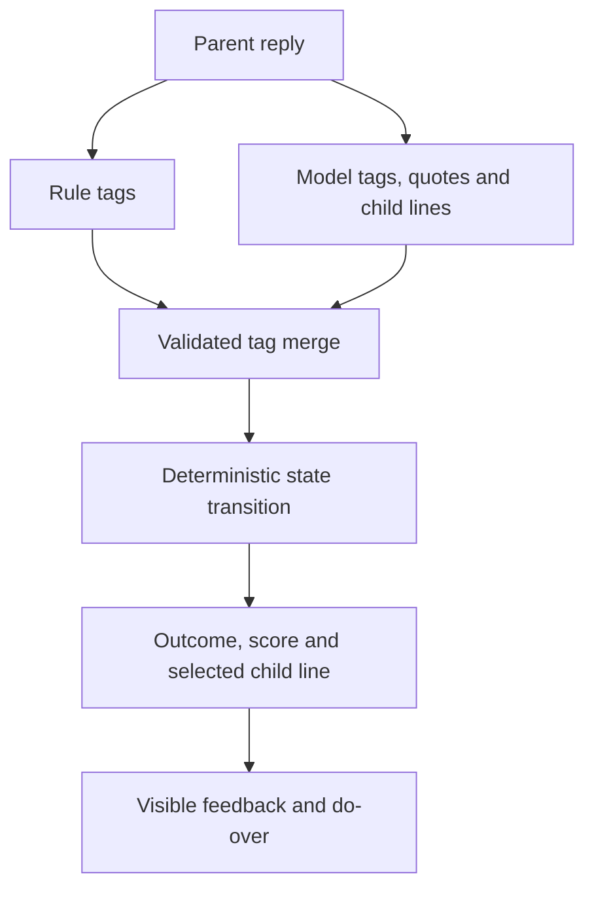

# Do-Over

Do-Over is a responsive practice simulator for parents of children aged 2–7. A parent answers a simulated child, sees the moves detected in their reply, and can return to any turn to try again. It needs no account. It is not therapy, medical advice or a diagnosis.

**Current status: development preview, not a finished release.** Track B's screens and client logic are implemented on `b4-landing-trust`. T0 API endpoints are explicit placeholders awaiting track A; they are not a real parenting simulation. Do not deploy this branch as a finished product or cite placeholder scores as results. Production URL: not yet configured.

## Run locally

Node 26 LTS is the deployment target. The initial dependency lock could not yet be generated in the restricted build environment; the first command resolves the packages. Commit the resulting `package-lock.json` before accepting T0; subsequent installs and CI use `npm ci`.

```sh
npm install
cp .env.example .env.local
npm run dev
```

Open http://localhost:3000. `NEXT_PUBLIC_PRO_PREVIEW=true` unlocks the available Pro UI; `false` exercises the Free limits. Change this build-time value before starting/building the app. Model keys belong only in server environment files. Voice is not enabled.

## What is implemented

- Warm responsive shell, scene intro, 8/20-second or off timer, 25 seconds after typing starts, keyboard input, evidence quotes, accessible meters and typed errors.
- Four outcomes, unsafe pause, turn-by-turn debrief, do-over from any turn, helpful-line saving, clipboard sharing and real-response daily standings.
- Scene library, custom-scene form, playbook and validated fragment sharing, history, New York daily streak and helpful-move percentages.
- Honest Free/Pro pricing and waitlist UI, engine-checked coach response display, landing live scene, privacy controls and missing-measurement states.
- VPS delivery with standalone Next.js, non-root container, Redis and Caddy; commit-verified deployment and rollback script.

## How it works



This is the target architecture. The real engine and provider chain are owned by track A and are not present in this branch yet. Temporary T0 code is explicitly marked; `src/lib/presentation.ts` must switch to engine exports in J1. The client never sends a state, tag list or score to the server.

## How to check that it is real

After A1–A3 integration, change the input and observe different tags, meter changes and outcomes. Run the golden-vector tests and evaluation; repeat a scene with provider keys removed to test the real rules-only path. These checks are not satisfied by the current placeholder endpoints.

```sh
npm run verify
npm run e2e
NEXT_PUBLIC_PRO_PREVIEW=false npm run e2e
npm run shots
E2E_BASE_URL=https://your-domain.example npm run e2e
```

Stop a previously running local dev server before switching preview flags. The Playwright configuration starts an unkeyed server for rules-only scenarios. `npm run shots` captures actual screens under `docs/build/shots/`; no screenshots have been fabricated or checked in. `E2E_BASE_URL` uses the selected server's actual configuration.

## Measured accuracy and limits

No production engine evaluation is available. `eval/labeled.jsonl` contains the supplied AI-drafted corpus; full human label review has not been confirmed. Dev and test splits must remain separate. The UI does not display a target as a measurement or fill missing results with estimates. `src/lib/evaluation.ts` is a validated display adapter whose JSON shape must be aligned with track A's actual output at J1.

The simulation's numerical model is a design choice, not a measurement of real children. Transfer to home behaviour, retention and willingness to pay have not been measured. Pro prices are hypotheses; payments are not connected. No invented users, testimonials or rankings are included.

## Validation actually performed

71 unit tests across 11 files passed using cached Vitest 1.6.1 and the bundled Zod 4 runtime from Zod 3.25.76. Strict TypeScript 5.9.2 with `noUncheckedIndexedAccess` passed for the contract, route stubs, client libraries, React store hook and pure presentation tests. The complete TSX source check reached only missing Next.js/CSS-module declarations, with no other reported errors; this is not a successful Next build. The deployment script passed 13 simulated shell scenarios.

`npm run verify` is blocked locally at the missing ESLint installation. Next.js, the full dependency lock, Docker, browser screenshots, axe scans, real-provider tests and production checks remain unverified. GitHub Actions runs failed before any steps started; the exact runner/account cause is not available through the current tools. See [the delivery report](docs/build/TRACK-B-REPORT.md) for the current acceptance gaps.

## Deploy

See [docs/DEPLOY.md](docs/DEPLOY.md). A person runs deployment on the VPS after stage acceptance. The deploy script requires a clean checkout, fast-forwards `main`, rebuilds containers, and accepts only an `ok: true` health response with the exact new commit. No production deployment has been made here.

## Repository map

| Location                                                  | Owner and purpose                                         |
| --------------------------------------------------------- | --------------------------------------------------------- |
| `src/engine`, `src/llm`, `src/server`, `src/app/api`      | Track A: engine, AI and server                            |
| `content`, `eval`                                         | Track A: scenes and measured evaluation                   |
| `src/shared/api.ts`, `src/engine/types.ts`                | Shared contract; freeze at T0 acceptance                  |
| Other `src/app`, `src/components`, `src/lib`, `src/voice` | Track B: pages and browser behaviour                      |
| `e2e`, deployment files                                   | Track B: browser checks and delivery                      |
| `docs/SPEC.md`, `docs/build`, `docs/reference`            | Supplied specification, stage tasks and reference vectors |

## How AI was used

Codex implemented the foundation and track B code with parallel implementation and independent review agents. Review found and fixed contract normalization, local deletion reporting, hidden-demo timers and ambiguous-request handling. The source kit and evaluation labels were supplied as AI-drafted material. No external Fable stage acceptance or human label verification is claimed.

## Sources and dependency checks

Product facts are restricted to SPEC §17: [U.S. Surgeon General, 2024](https://www.hhs.gov/surgeongeneral/reports-and-publications/parents/index.html), [Kaminski et al., 2008](https://pubmed.ncbi.nlm.nih.gov/18205039/), and [Parents Anonymous helplines](https://parentsanonymous.org/helplines/). The practice-transfer limitation accompanies the research statement.

Setup was checked against [Next.js installation](https://nextjs.org/docs/app/getting-started/installation), [Zod 4](https://zod.dev/v4), and [Node.js releases](https://nodejs.org/en/about/previous-releases). Package resolution still requires network access. Native `crypto.randomUUID` avoids an extra ID-generator dependency. Axe is included for the required accessibility acceptance scan.

## Licence

[MIT](LICENSE).
