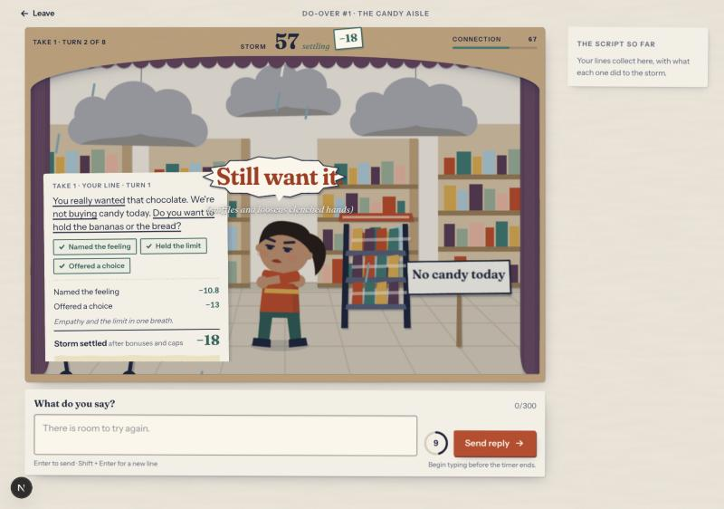
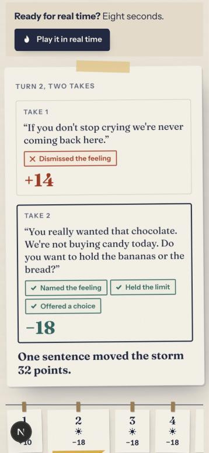
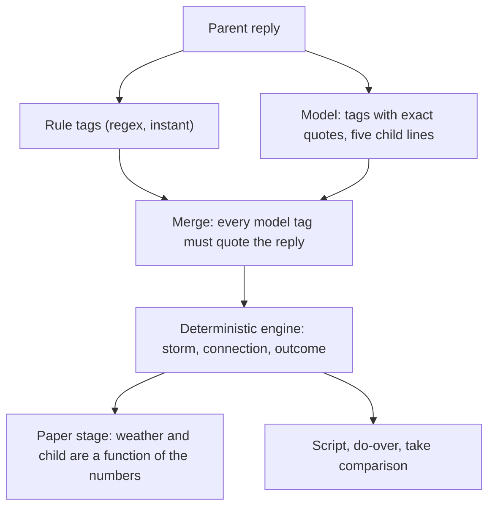

# Do-Over

**A paper-theatre stage where parents of 2–7 year olds rehearse the hardest minute of the day, a toddler meltdown, see exactly what their words did, and take it again.**

**Live:** [veltral.aituconnect.kz](https://veltral.aituconnect.kz) · no account needed · [Jury guide](https://veltral.aituconnect.kz/jury)

## Try it in 90 seconds

1. **Play today's meltdown** at [/play](https://veltral.aituconnect.kz/play). Read the child's line, answer in your own words. Your reply becomes a slip on the stage: a stamp for each move, a ledger of what each move did, the storm rising or settling.
2. **Do a turn over.** At the end, open the script and press **Do-over from here** on your worst turn. The stage rewinds to that moment; answer differently and the script shows Take 1 against Take 2.
3. **Open a locked scene** from [/scenes](https://veltral.aituconnect.kz/scenes). The paywall shows the price and a demo code: enter **ENCORE** (no payment), or use Stripe's test card `4242 4242 4242 4242` where checkout is shown. **Return to Free** on [/pricing](https://veltral.aituconnect.kz/pricing) locks it again.
4. **See a week of use** at [/progress](https://veltral.aituconnect.kz/progress): streak, level, this week's plan, your moves. Switch on **Show a sample week** to see seven days filled in (labelled as sample data).

| A reply on the stage                                                                          | Take 1 against Take 2                                                        |
| --------------------------------------------------------------------------------------------- | ---------------------------------------------------------------------------- |
|  |  |

## How it works



The child has two numbers, **storm** (arousal, 0–100) and **connection**. Nineteen tags (named the feeling, held the limit, offered a choice, threat, dismissed the feeling, …) each move them by fixed, tested amounts, with modifiers for repetition, connection, mixed messages, temperament and age. The stage draws those numbers: clouds hang lower and darker as the storm rises, rain starts at 45, lightning at 85, the child sits on the floor kicking above 85 and steps toward you when connection is high. [/how-it-works](https://veltral.aituconnect.kz/how-it-works) shows the tag table and constants straight from the code.

## What is real

- **The engine decides; the model only proposes.** `src/engine` is pure, synchronous TypeScript with 37 golden vectors. A language model may propose tags, but each must quote the reply exactly or it is dropped, and it never touches the outcome.
- **It works with the model off.** Without a provider key, rules tag the reply and written child lines speak; the slip says "Tagged by rules only".
- **Every number on screen comes from the engine** or from tested functions over your own browser history. The landing page's sample reply is scored by the real engine on every request.
- **Unsafe replies stop the scene** with no score and the National Parent & Youth Helpline.

## Measured accuracy

From [`eval/results.json`](eval/results.json), test split of 63 replies ([method and per-tag numbers](docs/MODEL.md)):

|                         | Rules only | Rules + OpenAI (`gpt-6-luna`) |
| ----------------------- | ---------: | ----------------------------: |
| Micro-F1                |      98.6% |                         96.6% |
| Exact-set match         |      96.8% |                         92.1% |
| Unhelpful-tag precision |       100% |                         89.7% |

The 137 labelled replies were drafted with an AI assistant; human review of every label is not recorded (`labelsReviewedByHuman: false`).

## What you pay for

Free, forever: today's meltdown, unlimited do-overs, the script, sharing, progress and the weekly plan.

**Season pass**, $9.99 a month or $59.99 a year, 7-day free trial: all twelve scenes, **Replay your own** (describe today's real meltdown and rehearse it), **What could I have said?** (alternatives checked by the engine), voice mode with a raised-voice check, and an unlimited playbook of your best lines.

The pass is a signed, httpOnly cookie, enforced on the server (`402 pro_required`). Checkout runs in **Stripe test mode**: the server refuses any key that does not start with `sk_test_`, so a real charge is impossible. Reviewers can use the demo code shown on the paywall.

Why people come back: a daily scene on a 12-day rotation with a streak, a three-item weekly plan built from your own slips and weakest move, seven moves that level up from "Rough cut" to "Second nature", and then-and-now after four scenes.

## Run locally

Node 24 or newer.

```sh
npm ci
cp .env.example .env.local
npm run dev
```

Open <http://localhost:3000>. With empty provider keys the game runs on rules. `NEXT_PUBLIC_PRO_PREVIEW=true` unlocks the season pass for development; otherwise the demo code is `ENCORE` in development. Full check: `npm run verify` (lint, types, unit tests, the evaluation gates, production build). Browser tests: see [`e2e/README.md`](e2e/README.md) and run them against a production build.

## Dependencies and services

- **Next.js 16** and **React 19**, **zod** for every API payload, **motion** for the stage's springs, **ioredis**.
- **OpenAI** (optional): tag proposals, child lines, custom scenes, coach suggestions, transcription and speech.
- **Stripe** (optional, test mode only): checkout for the season pass.
- **Redis**: sessions, rate limits, daily standings; falls back to bounded memory.
- No analytics SDKs, no account system, no third-party cookies. History, playbook and settings stay in the browser.

## How AI tools were used

AI coding agents wrote this code from a written spec. The v1 engine, model layer and interface were built by agents on two tracks and reviewed by a second model. The v2 redesign (the paper stage, play screen, season pass, landing and progress) was built by Claude Opus 5.5; the logo, brand kit and ten of the twelve stage sets by GPT (Astra). The team wrote the specs, reviewed screenshots and ran the deployment. The art is hand-written SVG and CSS: there are no generated images in the product. Build notes and the full v1 verification history are in [`docs/build/`](docs/build/).

## Limits

- The child is simulated and the scoring is a simplified teaching model, not a measurement of real children.
- We have not measured whether practice here changes what happens at home.
- English only; one parent's reply at a time; no accounts, so progress lives in one browser.
- The labelled set is small (137 replies) and AI-drafted.
- Do-Over is a practice tool. It is not therapy, medical advice or a diagnosis.

[MIT licence](LICENSE)
