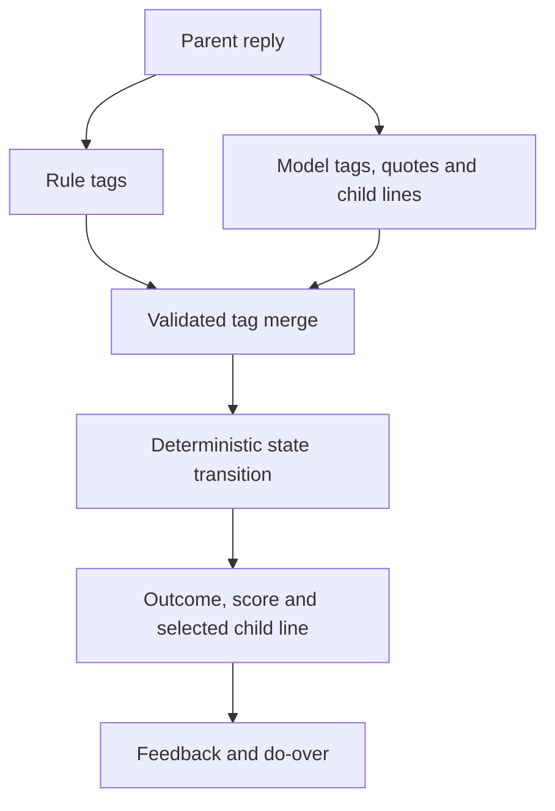

# Do-Over

Do-Over is a responsive practice simulator for parents of children aged 2–7. A parent answers a simulated child under time pressure, sees the moves detected in their reply and their effect on the meter, and can replay any turn. It needs no account. It is not therapy, medical advice or a diagnosis.

**Status: integrated development build; release acceptance is still pending.** The deterministic engine, provider adapters and real server routes from track A are integrated with track B's interface. The recorded measurements below come from the actual rules evaluation, not sample scores. A complete integrated build, browser checks and production deployment must be verified before release. **Production URL: not yet configured.**

## Run locally

Use Node 26 LTS and the committed dependency lockfile:

```sh
npm ci
cp .env.example .env.local
npm run dev
```

Open <http://localhost:3000>. For local links, set `SITE_URL=http://localhost:3000` in `.env.local`. Empty provider credentials run the deterministic rules and child templates. The UI identifies this as "Tagged by rules only"; unavailable model-only features show a useful error or fallback.

`NEXT_PUBLIC_PRO_PREVIEW=true` unlocks Pro features for evaluation; `false` exercises the Free limits. Change this build-time setting before starting or rebuilding the app. Keep model keys in server environment files. Voice is optional and requires its own configuration and HTTPS acceptance checks below.

## What is implemented

- A deterministic 19-tag engine, tested state transitions, scoring, breadth-first par calculation, 12 supplied scenes and New York daily rotation.
- OpenAI/Anthropic structured-output adapters, quote validation, a bounded provider fallback chain, rules-only operation and Redis-to-memory fallback.
- Responsive scene intro and play screens, 8/20-second or off timer, 25 seconds after typing begins, keyboard input, evidence quotes, accessible meters and typed error states.
- Four outcomes, an unscored unsafe pause, turn-by-turn debrief, do-over from any turn, helpful-line saving, clipboard sharing and standings from actual server responses.
- Scene library, custom-scene form and endpoint, playbook and validated fragment sharing, local history, daily streak and helpful-move percentages.
- Free/Pro limits, planned pricing with no checkout, waitlist persistence, engine-checked coach suggestions, landing practice scene, measured-results display and privacy controls.
- Standalone Next.js delivery with a non-root container, private Redis, Caddy HTTPS and a deploy script that verifies the new commit before reporting success.

The A5 endpoints and B5 voice interface are integrated: optional Pro voice mode, a three-second calibration, microphone recording capped at 11.8 seconds, sustained-window loudness detection, transcription, child playback and typing fallback. Voice defaults off. These paths are not considered accepted until the browser regression suite and real microphone tests on a phone and laptop pass. Live provider audio has not been verified.

## How it works



`src/engine` owns outcomes and scores. `src/llm` proposes semantic tags with evidence quotes and candidate child lines; it cannot decide whether a scene ends. `src/server` owns sessions, limits, storage and request handling, and `src/app/api` exposes the shared schemas. The browser renders responses and sends only a session ID, turn index and parent input; it never supplies authoritative state, tags or scores.

If the first model attempt fails or times out, the second provider is tried, then rules and deterministic templates continue the scene. Unsafe or empty replies skip the model. A do-over retains earlier turns and replaces the selected turn onward. Only eligible first daily attempts enter the real ranking, and percentages are withheld below 20 players.

## How to check that it is real

Change the reply and observe different tags, meter changes and outcomes: empathy with a boundary, a threat and giving in should not behave alike. Run the golden-vector tests and offline evaluation, then complete a scene with provider keys removed. Tests using fake providers exercise failure branches; they do not establish real provider accuracy.

```sh
npm run verify
npm run par
npm run check:eval-isolation
npm run e2e
NEXT_PUBLIC_PRO_PREVIEW=false npm run e2e
npm run shots
```

Stop a previously running local dev server before switching preview flags. Playwright starts an unkeyed local server for rules-only scenarios. CI covers both preview values. `npm run shots` captures actual application screens under `docs/build/shots/`; screenshots are not fabricated. Browser screenshots and accessibility results become acceptance evidence only after their commands finish successfully.

To check an actual deployed instance, set `E2E_BASE_URL` to its real HTTPS origin and run `npm run e2e`. That test uses the deployed server's configuration; changing a local flag does not change a remote build.

## Measured accuracy

These figures are read from the rules test block of [`eval/results.json`](eval/results.json), measured on 14 November 2026. [`docs/MODEL.md`](docs/MODEL.md) contains the generated per-tag table and methodology.

| Measurement                 |          Result |
| --------------------------- | --------------: |
| Test replies                |              63 |
| Rules-only micro-F1         |          98.59% |
| Exact-set match             |          96.83% |
| Precision on unhelpful tags |         100.00% |
| DISMISS recall / F1         | 66.67% / 80.00% |
| NAME_FEELING recall / F1    | 88.89% / 94.12% |
| Rules + model accuracy      |    Not measured |
| Live provider comparison    |    Not measured |

The corpus contains 137 AI-drafted replies: 74 dev and 63 test. Human review of all labels has **not** been confirmed; `labelsReviewedByHuman` is false. Dev is used for tuning and test for reporting. The labels are unchanged. The small test set and per-tag support limit what these scores establish. The measured engine is a practice-game model, not a measurement or prediction of a real child's behaviour.

No live model accuracy, provider winner or external-network latency is claimed. The model results block is `null` until credentials are configured and real measurements are run:

```sh
npm run eval:bakeoff -- --provider=openai
npm run eval:bakeoff -- --provider=anthropic
npm run eval:model
npm run latency
```

## Verification status

[`docs/build/TRACK-A-REPORT.md`](docs/build/TRACK-A-REPORT.md) records track A's completed checks in its own environment: a clean lockfile installation, `npm run verify` with 315 tests, a separate real-Redis run with 319 tests, all 37 golden vectors, all five evaluation gates and local standalone HTTP probes. Those are track A's results, not a substitute for testing the combined application.

Track B's deployment script passed 13 simulated shell scenarios; Compose and workflow YAML parsed successfully. The integrated engine and browser-unit subset passed **263 tests in 19 files**, including 23 voice tests. Lint and a scoped framework TypeScript check of all B pages, components, browser libraries, voice and E2E sources passed. These checks used available local package versions, not an exact lockfile installation. Full `npm run verify` and Next build are blocked by unavailable provider SDK/Redis dependencies; Chrome cannot launch in the sandbox (EPERM). Playwright execution, both preview settings, axe scans, screenshots, real microphone tests, Docker runtime and public HTTPS health checks remain unverified. See [`docs/build/TRACK-B-REPORT.md`](docs/build/TRACK-B-REPORT.md) for the dated execution evidence and remaining gates.

GitHub Actions attempts failed before running any steps. Track A's report identifies an account billing lock; no passing remote CI result is claimed. The committed lockfile is authoritative, so the temporary lockfile-generation workflow has been removed.

## Voice configuration and checks

The text path remains available when microphone recording is unsupported or permission is denied. Voice needs a secure browser context, an OpenAI key and configured `OPENAI_TRANSCRIBE_MODEL` / `OPENAI_TTS_MODEL` values. The input API accepts a single bounded recording up to 1 MB and 12 seconds, checks its actual media timing, and discards input audio after transcription. Browser capture should stop around 11.8 seconds to leave room for encoder padding. Speech synthesis only accepts a session and stored turn index; it cannot be used to speak arbitrary client text.

B5 acceptance requires a normal-voice calibration, a calm reply, a reply at least 10 dB above the baseline, microphone denial and text fallback on both a phone and laptop over HTTPS. A passing synthetic loudness test does not replace those real-device checks. Do not advertise voice as accepted until they are recorded.

## Limits and privacy

Transfer to home behaviour, retention and willingness to pay have not been measured. Pro prices are hypotheses, payments are not connected, and there are no invented users, testimonials or rankings. Do-Over is a rehearsal space, not therapy, diagnosis or medical advice.

History, playbook and settings stay in the browser. Playbook sharing puts its content in the URL fragment. Active sessions have a six-hour server lifetime, custom scenes 24 hours, and rankings store a random session ID and score. The waitlist stores the submitted email and plan. Model-enabled replies and scene descriptions are sent to the configured provider. Input recordings are discarded; generated child speech may be cached for the session. `/privacy` describes these flows and clears local browser data.

## Deploy

See [`docs/DEPLOY.md`](docs/DEPLOY.md). A person runs deployment on the VPS after review and stage acceptance. The script requires a clean checkout, fast-forwards `main`, rebuilds containers and succeeds only when public health reports `ok: true` with the exact new commit. Docker runtime and production deployment have not been verified here; no production URL is invented.

## Repository map

| Location                                                  | Owner and purpose                                |
| --------------------------------------------------------- | ------------------------------------------------ |
| `src/engine`, `src/llm`, `src/server`, `src/app/api`      | Track A: engine, AI and server                   |
| `content`, `eval`                                         | Track A: scenes and measured evaluation          |
| `src/shared/api.ts`, `src/engine/types.ts`                | Shared API and engine contract                   |
| Other `src/app`, `src/components`, `src/lib`, `src/voice` | Track B: pages and browser behaviour             |
| `e2e`, deployment files                                   | Track B: browser checks and delivery             |
| `docs/SPEC.md`, `docs/build`, `docs/reference`            | Specification, stage tasks and reference vectors |

## How AI was used

AI coding agents implemented the foundation, deterministic engine, provider layer, server APIs and interface, with parallel implementation and review work. The recorded B review fixed contract normalization, local deletion reporting, hidden-demo timers, ambiguous-request handling, a missed physical-violence threat in rules, microphone cancellation and delayed speech-onset detection. The supplied kit and labelled corpus were AI-drafted. Model names, independent Fable acceptance and human label verification are not inferred from the plan or asserted without an actual record. The stage reports distinguish generated code, executed checks and outstanding human review.

## Sources and dependencies

Product facts are restricted to SPEC §17: [U.S. Surgeon General, 2024](https://www.hhs.gov/surgeongeneral/reports-and-publications/parents/index.html), [Kaminski et al., 2008](https://pubmed.ncbi.nlm.nih.gov/18205039/), and [Parents Anonymous helplines](https://parentsanonymous.org/helplines/). The practice-transfer limitation accompanies the research statement.

Setup was checked against [Next.js installation](https://nextjs.org/docs/app/getting-started/installation), [Zod 4](https://zod.dev/v4), and [Node.js releases](https://nodejs.org/en/about/previous-releases). `package-lock.json` fixes the installed dependency graph; use `npm ci` to reproduce it. TypeScript 6.0.3 matches the parser range recorded by track A. Native `crypto.randomUUID` avoids an additional ID generator. Axe supports the required accessibility scan.

## Licence

[MIT](LICENSE).
