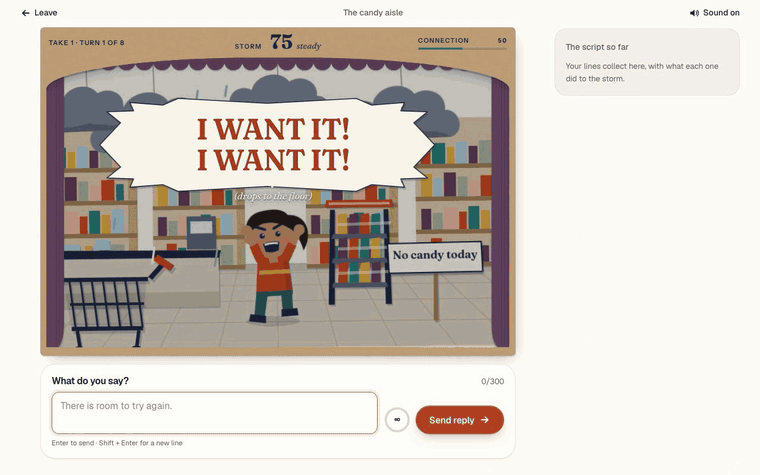
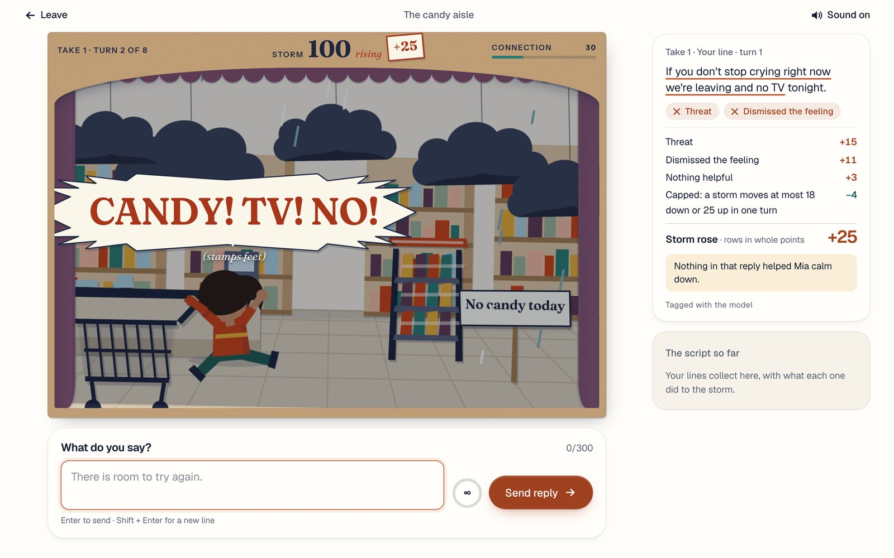
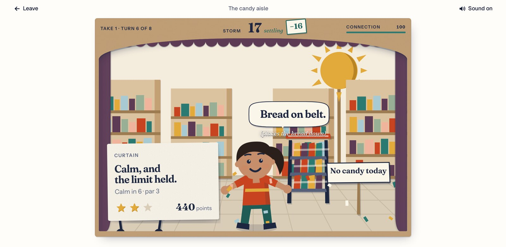
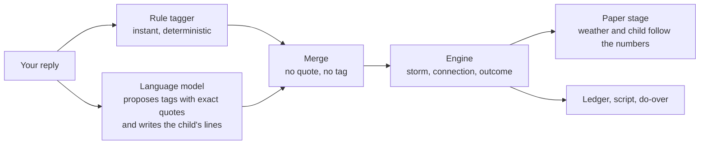
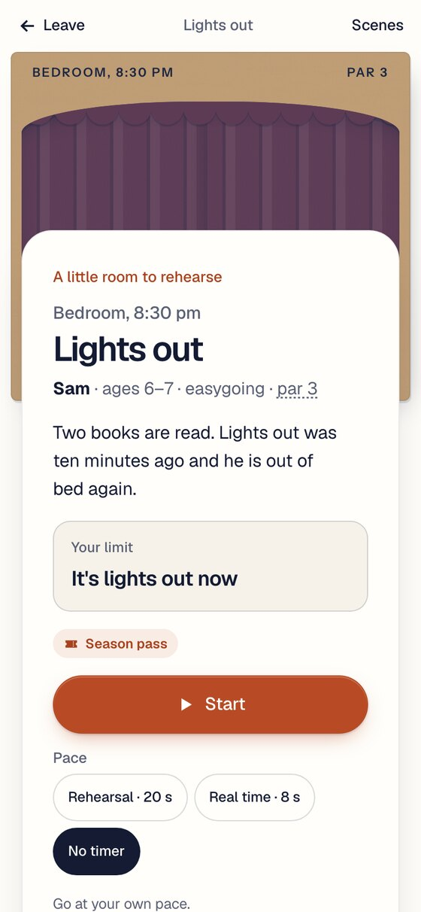

<p align="center">
  <a href="https://veltral.aituconnect.kz">
    <picture>
      <source media="(prefers-color-scheme: dark)" srcset="docs/screenshots/hero-dark.jpg">
      
    </picture>
  </a>
</p>

<h1 align="center">Veltral</h1>

<p align="center">
  <strong>The flight simulator for the hardest minute of parenting.</strong><br>
  Answer a screaming child in your own words, see exactly what your words did, then rewind and take it again.
</p>

<p align="center">
  <a href="https://veltral.aituconnect.kz"></a>
  <a href="https://veltral.aituconnect.kz/play"></a>
  <a href="https://veltral.aituconnect.kz/jury"></a>
</p>

<p align="center">
  
  
  
  
  
  <a href="LICENSE"></a>
</p>

<p align="center">
  
</p>

<p align="center">
  <em>Recorded on the live site, not staged. A threat: storm 75 → 100. Then empathy, the limit and a choice: −18.<br>
  The weather, the child and the ledger are all drawn from the engine's numbers.</em>
</p>

<table align="center">
  <tr>
    <td align="center"><h3>12</h3>scenes,<br>ages 2 to 7</td>
    <td align="center"><h3>19</h3>moves the engine<br>can name</td>
    <td align="center"><h3>3 min</h3>from landing page<br>to a finished scene</td>
    <td align="center"><h3>587</h3>automated<br>tests</td>
    <td align="center"><h3>37</h3>golden vectors<br>pin the engine</td>
    <td align="center"><h3>0</h3>accounts<br>or trackers</td>
  </tr>
</table>

<p align="center">
  <a href="#the-problem">Problem</a> ·
  <a href="#one-moment-two-takes">Two takes</a> ·
  <a href="#try-it-in-90-seconds">Try it</a> ·
  <a href="#why-it-is-different">Why different</a> ·
  <a href="#how-it-works">How it works</a> ·
  <a href="#what-is-inside">Inside</a> ·
  <a href="#what-you-pay-for-and-why-you-come-back">Pricing</a> ·
  <a href="#measured-with-its-limits">Accuracy</a> ·
  <a href="#engineering">Engineering</a> ·
  <a href="#run-it-locally">Run</a>
</p>

<p align="center">
  Built for Business Cup 2.0 · track <strong>Skills</strong> · for working parents in the US with a child aged 2–7
</p>

---

## The problem

Parents who have read the books know what to say: name the feeling, hold the limit, offer a choice. In the third minute of screaming at a supermarket checkout they threaten, bribe or yell anyway, and feel bad about it that night.

**Knowing the script is not the same as being able to say it under pressure.** Books, courses and memberships sell knowledge. Nothing sells repetitions.

> **48%** of parents say that most days their stress is completely overwhelming, compared to 26% among other adults.
> — [U.S. Surgeon General's Advisory, 2024](https://www.hhs.gov/surgeongeneral/reports-and-publications/parents/index.html)

Pilots do not learn engine failure from a book. They fly it in a simulator until their hands know what to do. Veltral is that simulator for a toddler meltdown: a place to get the repetitions, where nothing is at stake.

## One moment, two takes

Both screenshots are from **one real session** on the live site. The parent threatened and the storm hit 100. Then they pressed **Do-over from here** and tried other words.

<table>
  <tr>
    <th width="50%">Take 1 · a threat · storm <code>+25</code></th>
    <th width="50%">Take 2 · empathy, the limit, a choice · storm <code>−18</code></th>
  </tr>
  <tr>
    <td></td>
    <td></td>
  </tr>
  <tr>
    <td><em>“If you don't stop crying right now we're leaving and no TV tonight.”</em><br>Threat +15 · Dismissed the feeling +11</td>
    <td><em>“You really wanted that chocolate. No candy today. Want to push the cart or hold the bananas?”</em><br>Named the feeling −11 · Offered a choice −13 · Empathy and the limit together −6</td>
  </tr>
</table>

Every reply becomes a slip beside the stage: the words that counted are underlined, each move is named, and a ledger shows what every move did and adds up to the total. Keep going and the weather clears:

<p align="center">
  
</p>

## Try it in 90 seconds

|       | Do this                                                                                                                                 | You will see                                                                                                                                                  |
| :---: | --------------------------------------------------------------------------------------------------------------------------------------- | ------------------------------------------------------------------------------------------------------------------------------------------------------------- |
| **1** | **Play today's meltdown** at [/play](https://veltral.aituconnect.kz/play). Answer however you like: a threat, nonsense, something kind. | Your words stamped and scored, the storm and the child reacting.                                                                                              |
| **2** | When the scene ends, press **Do-over from here** on your worst turn.                                                                    | The stage rewinds to that moment. The clapperboard says Take 2.                                                                                               |
| **3** | Open a locked scene from [/scenes](https://veltral.aituconnect.kz/scenes) and enter the demo code **`ENCORE`**.                         | The paywall, the price, and the season pass opening with no payment. **Return to Free** on [/pricing](https://veltral.aituconnect.kz/pricing) locks it again. |
| **4** | Open [/progress](https://veltral.aituconnect.kz/progress) and switch on **Show a sample week**.                                         | A streak, a level and a weekly plan filled in, labelled as sample data on every card.                                                                         |

## Why it is different

|                                                            | What you do                                               | What you get back                                                                           |
| ---------------------------------------------------------- | --------------------------------------------------------- | ------------------------------------------------------------------------------------------- |
| Courses and memberships (Good Inside, Big Little Feelings) | Watch and read                                            | Knowledge                                                                                   |
| Scenario quiz apps (Kapi)                                  | Pick one of four prepared answers                         | An explanation of the right answer                                                          |
| AI chat companions                                         | Chat with a model that also decides how it went           | Whatever the model says                                                                     |
| **Veltral**                                                | **Say it yourself, under a clock, to a child who reacts** | **Every move in your words named and scored by a tested engine, and a rewind to try again** |

Picking the right answer from four is easy. Producing it while a child screams is the skill.

## How it works



The child has two numbers: **storm** (arousal, 0–100) and **connection**. Nineteen tags move them by fixed, tested amounts: seven helpful moves (named the feeling, held the limit, offered a choice, connected, clear instruction, specific praise, when–then) and twelve unhelpful ones (threat, bribe, raised voice, shaming, dismissing the feeling, lecture and others). Modifiers account for repeating yourself, low or high connection, mixed messages, the child's temperament and age.

The scene ends calm when the storm falls to 25 or lower with the limit intact, ends "quiet, but the limit is gone" if you give in, and runs out after eight turns. A reply that describes hurting or degrading a child stops the scene with no score and shows the National Parent & Youth Helpline.

The teaching model behind the numbers is simple and shown on [/how-it-works](https://veltral.aituconnect.kz/how-it-works), which renders the tag table and constants straight from the code: connect before you direct; empathy and the limit together beat either alone; choices help; harsh words cancel kind ones; bribes work now and cost later.

### Real, not a wrapper

<table>
  <tr>
    <td width="50%" valign="top">
      <strong>The engine decides. The model only proposes.</strong><br>
      <code>src/engine</code> is pure, synchronous TypeScript checked against 37 golden vectors. A model tag is dropped unless it quotes the reply exactly, and the model never touches the outcome.
    </td>
    <td width="50%" valign="top">
      <strong>It works with the model switched off.</strong><br>
      Without a provider key, rules tag the reply and written lines speak for the child. Each slip says whether it was “Tagged with the model” or “Tagged by rules only”.
    </td>
  </tr>
  <tr>
    <td valign="top">
      <strong>Every number on screen comes from the engine</strong><br>
      or from tested functions over your own history. The sample reply on the landing page is scored by the real engine on every request.
    </td>
    <td valign="top">
      <strong>Negation is read, not pattern-matched.</strong><br>
      “You are not selfish” and “You don't have to stop crying” are not mistaken for shaming or dismissing; “Fine, you can hold my hand. No candy today.” is not giving in.
    </td>
  </tr>
</table>

## What is inside

<p align="center">
  
</p>

<p align="center"><em>Twelve stages, twelve children, three age bands. Every set is hand-written SVG; the clouds and rain follow the storm.</em></p>

<table>
  <tr>
    <td width="34%" align="center" valign="top">
      
    </td>
    <td valign="top">
      <h3>A scene in three minutes</h3>
      <ul>
        <li><strong>A new shared scene every day</strong> with a par, stars and a streak.</li>
        <li><strong>Three paces:</strong> 20 seconds for a first run, 8 seconds as in real life, or no timer. The clock waits while the tab is hidden.</li>
        <li><strong>The script:</strong> every turn with its stamps, ledger and notes. The turning point is flagged, and a free “try instead” line on your worst turn can be replayed with one press.</li>
        <li><strong>Replay your own:</strong> describe a real meltdown from today in a sentence or two and rehearse it as a new scene.</li>
        <li><strong>Your lines:</strong> save replies that worked and share the playbook with a co-parent through a link that carries its data in the URL fragment and never reaches the server.</li>
        <li><strong>Voice mode:</strong> say it out loud; a raised voice is detected from loudness and tagged.</li>
        <li><strong>Built for a phone first,</strong> with light and dark themes, keyboard play, screen-reader announcements and reduced-motion support.</li>
      </ul>
      A spoiler-free result to share:
      <pre>Veltral #2 · Leaving the playground
🟥🟩🟩🟩 Calm in 4 (par 3) ★★</pre>
    </td>
  </tr>
</table>

## What you pay for, and why you come back

|                                                              |     Free      | Season pass |
| ------------------------------------------------------------ | :-----------: | :---------: |
| Today's meltdown, unlimited do-overs, the script, sharing    |       ✓       |      ✓      |
| Progress, weekly plan and streak                             |       ✓       |      ✓      |
| Scene library                                                | Today's scene | All twelve  |
| Replay your own meltdown                                     |       —       |      ✓      |
| "What could I have said?" alternatives checked by the engine |       —       |      ✓      |
| Voice mode                                                   |       —       |      ✓      |
| Your lines (playbook)                                        |    5 lines    |  Unlimited  |

<p align="center"><strong>$9.99 a month or $59.99 a year, with a 7-day free trial.</strong></p>

<p align="center">
  
</p>

The pass is a signed, httpOnly cookie enforced on the server: gated endpoints answer `402 pro_required` without it. A test-mode Stripe checkout is built in and appears when a `sk_test_` key is configured; the server refuses any other key, so a real charge is impossible. The live site offers the demo code `ENCORE` so reviewers can pass the paywall without a card.

<table>
  <tr>
    <td width="52%" valign="top">
      
    </td>
    <td valign="top">
      <h3>Why a parent renews</h3>
      <ul>
        <li><strong>The need lasts for years, not weeks.</strong> A two-year-old's meltdowns become a six-year-old's arguments about fairness, and the scenes follow.</li>
        <li><strong>Replay your own</strong> turns every real meltdown at home into new practice, so the content never runs out.</li>
        <li><strong>The weekly plan</strong> is built from your own most frequent slip and your least-used move, and ticks itself off as you play.</li>
        <li><strong>Seven moves rank up</strong> from “Rough cut” to “Second nature”; then-and-now compares your first scenes with your latest.</li>
        <li><strong>The playbook grows</strong> and is shared with the other parent.</li>
      </ul>
    </td>
  </tr>
</table>

## Measured, with its limits

Tagging accuracy on the held-out test split (63 of 137 labelled replies), from [`eval/results.json`](eval/results.json). Method and per-tag numbers: [`docs/MODEL.md`](docs/MODEL.md).

|                         | Rules only | Rules + model (`gpt-6-luna`) |
| ----------------------- | ---------: | ---------------------------: |
| Micro-F1                |      98.6% |                        96.6% |
| Exact-set match         |      96.8% |                        92.1% |
| Unhelpful-tag precision |       100% |                        89.7% |

Five gates run on every `npm run verify`: unsafe replies are always caught in rules-only mode, empty and shouted replies are tagged exactly, and two prompt-injection replies get no tags. The labelled set was drafted with an AI assistant and a human review of every label is not recorded (`labelsReviewedByHuman: false`), so read these figures as a regression check, not as proof.

## Engineering

|                          |                                                                                                                                                                                |
| ------------------------ | ------------------------------------------------------------------------------------------------------------------------------------------------------------------------------ |
| **Tested**               | 587 unit and integration tests in 40 files; strict TypeScript with no `any`; ESLint clean; Playwright suites for the main loop, the paywall, retention, trust pages and voice. |
| **Server-authoritative** | The browser never sends state, tags or scores. Every request and response is validated with zod schemas from one shared contract, [`src/shared/api.ts`](src/shared/api.ts).    |
| **Resilient**            | Two model attempts with hard timeouts, then rules for that turn; a daily model-call cap; Redis with a bounded in-memory fallback; per-IP rate limits.                          |
| **Injection-aware**      | The parent's reply travels as data inside a JSON field and is never placed in the system prompt.                                                                               |
| **Private by default**   | No account, no analytics SDK, no third-party cookies. History, playbook and settings stay in the browser. Server sessions expire after 6 hours.                                |
| **The stage is code**    | The proscenium, twelve sets, weather and every child are hand-written SVG and CSS driven by one pure, tested function of the engine state.                                     |

<details>
<summary><strong>Repository map</strong></summary>

<br>

| Path                                        | What it holds                                                                                                     |
| ------------------------------------------- | ----------------------------------------------------------------------------------------------------------------- |
| `src/engine`                                | Tags, rule tagger, merge, state transition, scoring, par, daily rotation. Pure and synchronous                    |
| `src/llm`                                   | Provider adapters, prompts, the turn call, custom scenes, coach, speech                                           |
| `src/server`                                | Sessions, Redis, rate limits, daily standing, season-pass cookie                                                  |
| `src/app/api`                               | Route handlers: session, turn, coach, custom-scene, daily, entitlement, checkout, redeem, voice                   |
| `src/shared/api.ts`                         | The API contract as zod schemas                                                                                   |
| `src/components/stage`                      | The paper stage: sets, props, weather, the child, mood                                                            |
| `src/components/play`                       | Play screen, turn slip and ledger, endings, the script, do-over                                                   |
| `src/components/paywall`, `src/app/pricing` | Paywall and season pass                                                                                           |
| `src/lib`                                   | Browser store, progress, weekly plan, moves, share text                                                           |
| `content`                                   | Scenes, tips, child-line templates, par                                                                           |
| `eval`                                      | Labelled replies, the evaluation runner and results                                                               |
| `e2e`                                       | Playwright suites                                                                                                 |
| `docs`                                      | [SPEC](docs/SPEC.md), [REDESIGN](docs/REDESIGN.md), [MODEL](docs/MODEL.md), [DEPLOY](docs/DEPLOY.md), build notes |

</details>

## Run it locally

Node 24 or newer.

```sh
npm ci
cp .env.example .env.local
npm run dev
```

Open <http://localhost:3000>. With no provider key the game runs on rules, and the demo code `ENCORE` opens the season pass.

```sh
npm run verify   # lint, types, unit tests, evaluation gates, production build
npm run e2e      # browser tests, see e2e/README.md
npm run eval     # rules-only tagging accuracy, offline
npm run par      # recompute the par of every scene
```

<details>
<summary><strong>Environment variables</strong></summary>

<br>

Every name is documented in [`.env.example`](.env.example). The ones that matter:

| Variable                                      | Purpose                                                                            |
| --------------------------------------------- | ---------------------------------------------------------------------------------- |
| `OPENAI_API_KEY`, `OPENAI_MODEL`              | Optional. Tag proposals, child lines, custom scenes, coach. Empty means rules-only |
| `OPENAI_TRANSCRIBE_MODEL`, `OPENAI_TTS_MODEL` | Optional. Voice mode                                                               |
| `REDIS_URL`                                   | Sessions, rate limits, daily standing. Falls back to memory                        |
| `ENTITLEMENT_SECRET`                          | Signs the season-pass cookie                                                       |
| `DEMO_CODE`                                   | The code shown on the paywall for reviewers                                        |
| `STRIPE_SECRET_KEY`                           | Optional. Test-mode checkout; only `sk_test_` keys are accepted                    |
| `NEXT_PUBLIC_PRO_PREVIEW`                     | `true` unlocks everything for development; production uses `false`                 |

Deployment (Docker Compose with Redis behind nginx or Caddy) is described in [`docs/DEPLOY.md`](docs/DEPLOY.md). `/api/health` reports the running commit.

</details>

## Built with

<p>
  
  
  
  
  
  
  
  
  
  
</p>

## How AI tools were used

The team wrote the product spec and the redesign brief, reviewed every screen and ran the deployment. AI coding agents (Claude and GPT models) wrote and reviewed the code against those documents, and the labelled evaluation set was drafted with an AI assistant. At runtime a language model proposes tags and writes the child's lines; it never decides an outcome. Build notes and verification history are in [`docs/build/`](docs/build/).

## Limits

- The child is simulated and the scoring is a simplified teaching model. The numbers are design choices for a practice game, not measurements of real children.
- A meta-analysis of 77 parent-training evaluations found larger effects for programs that had parents practise new skills with their own child ([Kaminski et al., 2008](https://pubmed.ncbi.nlm.nih.gov/18205039/)). Veltral is rehearsal against a simulated child; we have not measured whether practice here changes what happens at home.
- English only. No accounts, so progress lives in one browser.
- The labelled set is small and AI-drafted.
- Veltral is a practice tool. It is not therapy, medical advice or a diagnosis.

---

<p align="center">
  <strong>You know what to say. Until they scream.</strong><br>
  <a href="https://veltral.aituconnect.kz/play">Rehearse it now</a> · <a href="LICENSE">MIT licence</a> · © 2026 Veltral
</p>
